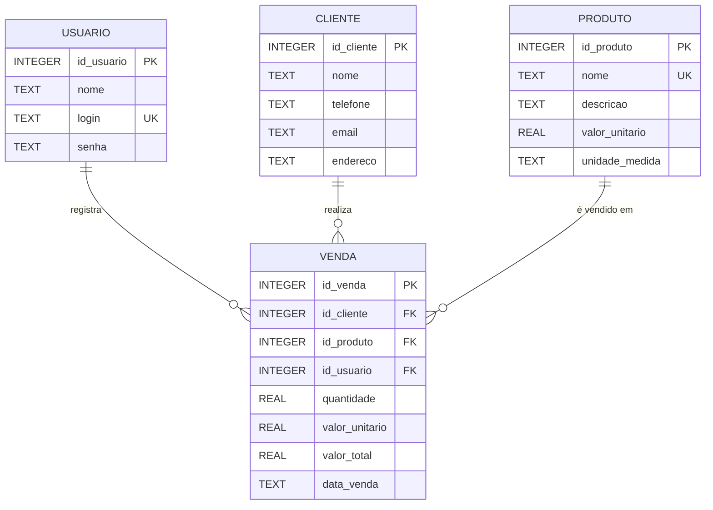

# Modelo ER do Banco de Dados Local – AgroVende

Banco de dados local (SQLite) com 4 tabelas: `usuario`, `cliente`, `produto` e `venda`.

## Diagrama Entidade-Relacionamento



## Tabelas

### `usuario`

| Coluna       | Tipo    | Restrições            |
|--------------|---------|-----------------------|
| `id_usuario` | INTEGER | PK, AUTOINCREMENT     |
| `nome`       | TEXT    | NOT NULL              |
| `login`      | TEXT    | NOT NULL, UNIQUE      |
| `senha`      | TEXT    | NOT NULL              |

### `cliente`

| Coluna       | Tipo    | Restrições            |
|--------------|---------|-----------------------|
| `id_cliente` | INTEGER | PK, AUTOINCREMENT     |
| `nome`       | TEXT    | NOT NULL              |
| `telefone`   | TEXT    | NOT NULL              |
| `email`      | TEXT    | Opcional              |
| `endereco`   | TEXT    | Opcional              |

### `produto`

| Coluna           | Tipo    | Restrições                     |
|------------------|---------|--------------------------------|
| `id_produto`     | INTEGER | PK, AUTOINCREMENT              |
| `nome`           | TEXT    | NOT NULL, UNIQUE               |
| `descricao`      | TEXT    | Opcional                       |
| `valor_unitario` | REAL    | NOT NULL, CHECK (>= 0)         |
| `unidade_medida` | TEXT    | NOT NULL (kg, und, duzia...)   |

### `venda`

| Coluna           | Tipo    | Restrições                              |
|------------------|---------|-----------------------------------------|
| `id_venda`       | INTEGER | PK, AUTOINCREMENT                       |
| `id_cliente`     | INTEGER | NOT NULL, FK → `cliente.id_cliente`     |
| `id_produto`     | INTEGER | NOT NULL, FK → `produto.id_produto`     |
| `id_usuario`     | INTEGER | NOT NULL, FK → `usuario.id_usuario`     |
| `quantidade`     | REAL    | NOT NULL, CHECK (> 0)                   |
| `valor_unitario` | REAL    | NOT NULL, CHECK (>= 0)                  |
| `valor_total`    | REAL    | NOT NULL, CHECK (>= 0)                  |
| `data_venda`     | TEXT    | NOT NULL (formato AAAA-MM-DD)           |

## Relacionamentos

- **cliente → venda (1:N):** um cliente pode ter várias vendas; cada venda pertence a um cliente.
- **produto → venda (1:N):** um produto pode estar em várias vendas; cada venda tem um produto.
- **usuario → venda (1:N):** um vendedor registra várias vendas; cada venda tem um vendedor responsável.

## Script de criação

```sql
PRAGMA foreign_keys = ON;

CREATE TABLE usuario (
    id_usuario INTEGER PRIMARY KEY AUTOINCREMENT,
    nome       TEXT NOT NULL,
    login      TEXT NOT NULL UNIQUE,
    senha      TEXT NOT NULL
);

CREATE TABLE cliente (
    id_cliente INTEGER PRIMARY KEY AUTOINCREMENT,
    nome       TEXT NOT NULL,
    telefone   TEXT NOT NULL,
    email      TEXT,
    endereco   TEXT
);

CREATE TABLE produto (
    id_produto     INTEGER PRIMARY KEY AUTOINCREMENT,
    nome           TEXT NOT NULL UNIQUE,
    descricao      TEXT,
    valor_unitario REAL NOT NULL CHECK (valor_unitario >= 0),
    unidade_medida TEXT NOT NULL
);

CREATE TABLE venda (
    id_venda       INTEGER PRIMARY KEY AUTOINCREMENT,
    id_cliente     INTEGER NOT NULL,
    id_produto     INTEGER NOT NULL,
    id_usuario     INTEGER NOT NULL,
    quantidade     REAL NOT NULL CHECK (quantidade > 0),
    valor_unitario REAL NOT NULL CHECK (valor_unitario >= 0),
    valor_total    REAL NOT NULL CHECK (valor_total >= 0),
    data_venda     TEXT NOT NULL,
    FOREIGN KEY (id_cliente) REFERENCES cliente (id_cliente),
    FOREIGN KEY (id_produto) REFERENCES produto (id_produto),
    FOREIGN KEY (id_usuario) REFERENCES usuario (id_usuario)
);
```
